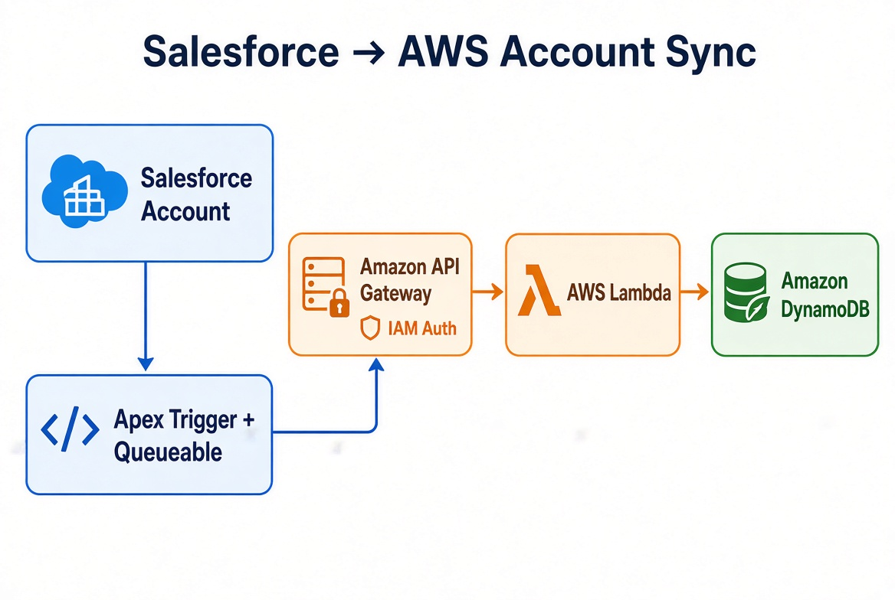
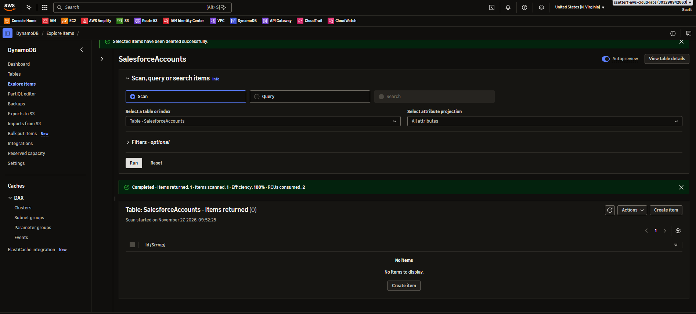
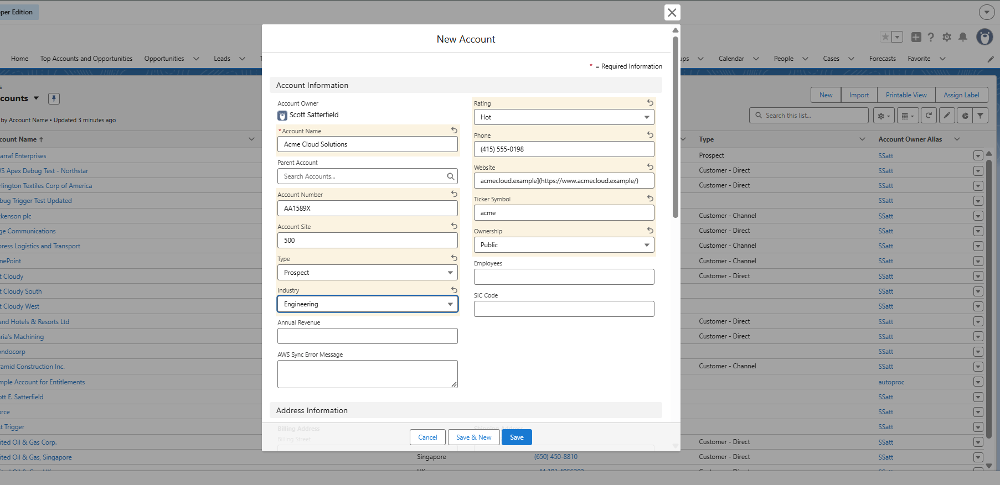
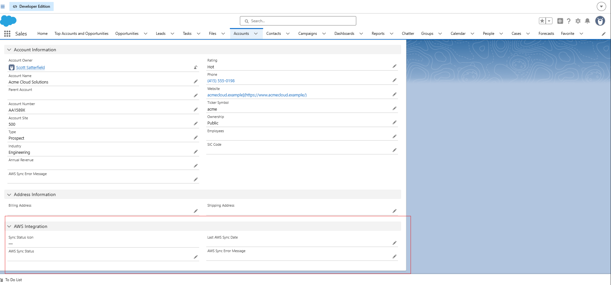
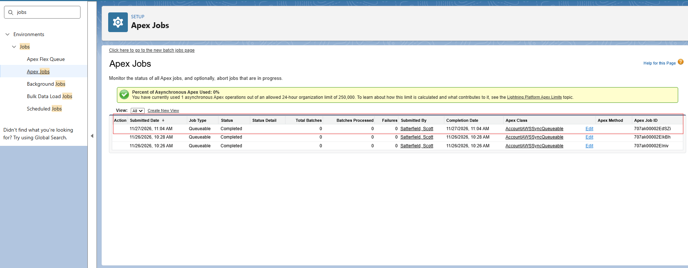
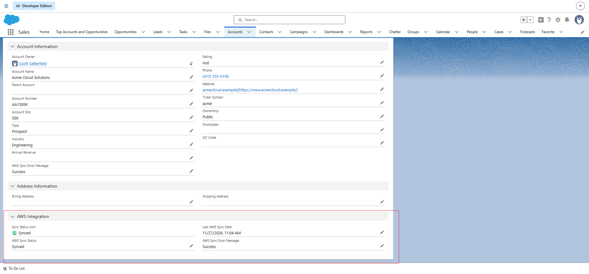
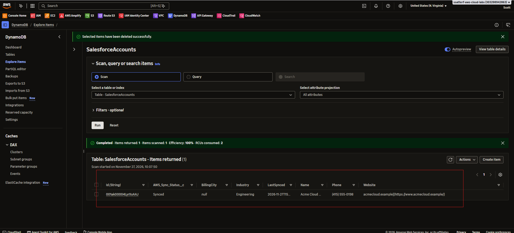
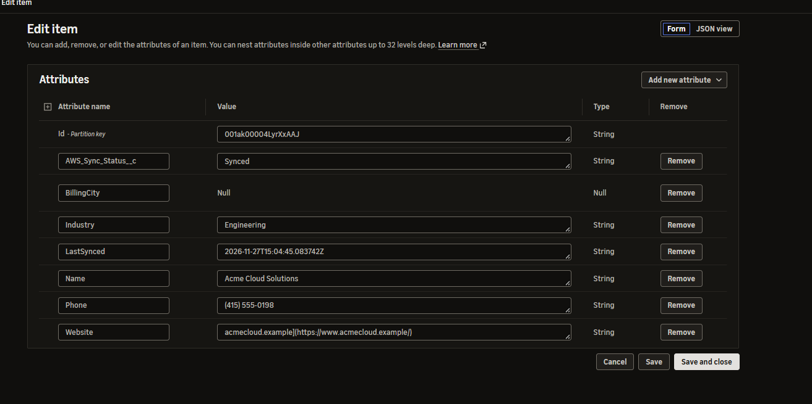
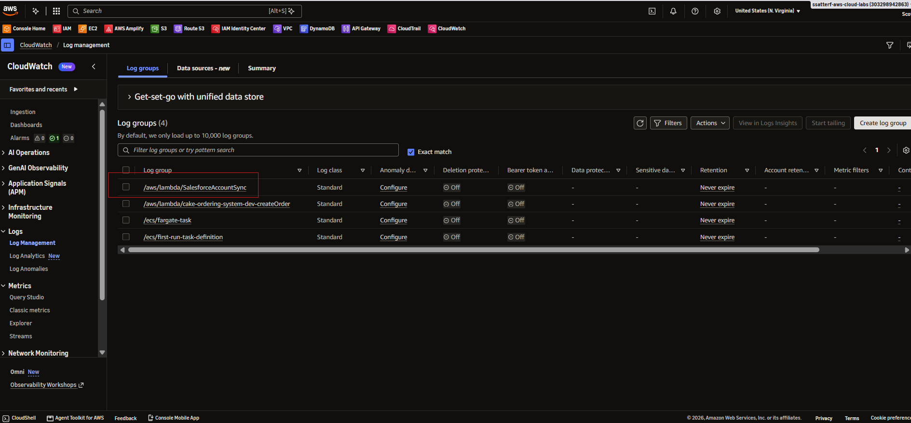
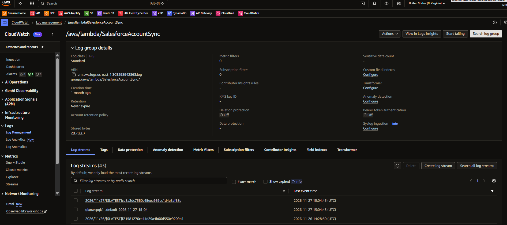

# Salesforce Account → AWS Real-time Sync

Real-time integration that syncs Salesforce Account records to Amazon DynamoDB using API Gateway and Lambda. It includes custom field tracking, success/error logging, and IAM-secured API access.

## Architecture



## Flow

1. An Account is created or updated in Salesforce.
2. The Apex trigger enqueues `AccountAWSSyncQueueable`.
3. The queueable performs a callout through the `AWS_Account_Sync` Named Credential.
4. IAM authorization secures the API Gateway request.
5. Lambda writes the Account data to the `SalesforceAccounts` DynamoDB table.
6. Salesforce updates `AWS_Sync_Status__c`, `Last_AWS_Sync_Date__c`, and `AWS_Sync_Error_Message__c`.

## Features

- Real-time sync on Account create/update
- Filters updates to relevant fields with `AccountAWSSyncHandler`
- Queueable Apex for asynchronous callouts
- Custom Account fields for tracking:
  - `AWS_Sync_Status__c` — `Pending`, `Synced`, or `Failed`
  - `Last_AWS_Sync_Date__c`
  - `AWS_Sync_Error_Message__c`
- AWS Signature Version 4 authentication through Salesforce Named/External Credentials
- DynamoDB item creation and CloudWatch log visibility
- Success and failure status updates in Salesforce

## Tech Stack

| Layer | Technology |
|---|---|
| CRM | Salesforce Apex Trigger and Queueable |
| Authentication | Named Credential and External Credential (AWS Signature V4) |
| API | Amazon API Gateway HTTP API |
| Compute | AWS Lambda (Python 3) |
| Database | Amazon DynamoDB |
| Observability | Amazon CloudWatch Logs |

## Project Structure

```text
salesforce-aws-account-sync/
├── force-app/main/default/
│   ├── classes/
│   │   ├── AccountAWSSyncHandler.cls
│   │   ├── AccountAWSSyncQueueable.cls
│   │   └── AccountAWSSyncHandlerTest.cls
│   ├── objects/Account/fields/
│   │   ├── AWS_Sync_Status__c.field-meta.xml
│   │   └── Last_AWS_Sync_Date__c.field-meta.xml
│   └── triggers/
│       └── AccountAWSSyncTrigger.trigger
├── aws-code/
│   ├── lambda/salesforce_account_sync.py
│   └── IAM/dynamodb-policy.json
├── images/
│   ├── Architecture.png
│   └── 01-Empty-DynamoDB.png through 09-CloudWatch-Activity-Logging.png
├── sfdx-project.json
└── README.md
```

## Setup Overview

### Salesforce

1. Deploy the custom fields, Apex handler, queueable class, and Account trigger.
2. Create an External Credential configured for AWS Signature Version 4.
3. Create the Named Credential `AWS_Account_Sync` and point it to your API Gateway invoke URL.
4. Assign the External Credential Principal to an appropriate Permission Set.

### AWS

1. Create the `SalesforceAccounts` DynamoDB table with `Id` as the partition key.
2. Deploy `aws-code/lambda/salesforce_account_sync.py` as a Lambda function.
3. Grant the Lambda execution role permission to `dynamodb:PutItem` using `aws-code/IAM/dynamodb-policy.json`.
4. Create an HTTP API in API Gateway with IAM authorization.
5. Configure Salesforce and AWS so the Named Credential signs requests for the API resource.

## Security

- API Gateway is protected with AWS IAM authorization.
- Salesforce signs callouts with AWS Signature Version 4 through Named/External Credentials.
- DynamoDB access is limited to the Lambda integration role.
- No AWS credentials are hard-coded in Apex.

## Screenshots

### 1. DynamoDB before the first sync



### 2. Create a Salesforce Account



### 3. Save the Account and show the AWS integration fields



### 4. Apex Queueable jobs



### 5. Refresh and verify the Salesforce sync status



### 6. Find the synced item in DynamoDB



### 7. DynamoDB item populated from Salesforce



### 8. Lambda log group in CloudWatch



### 9. Lambda log stream details



## Author

[Scott E Satterfield](https://github.com/ssatterfi)

## License

This project is open source and available under the [MIT License](LICENSE).
